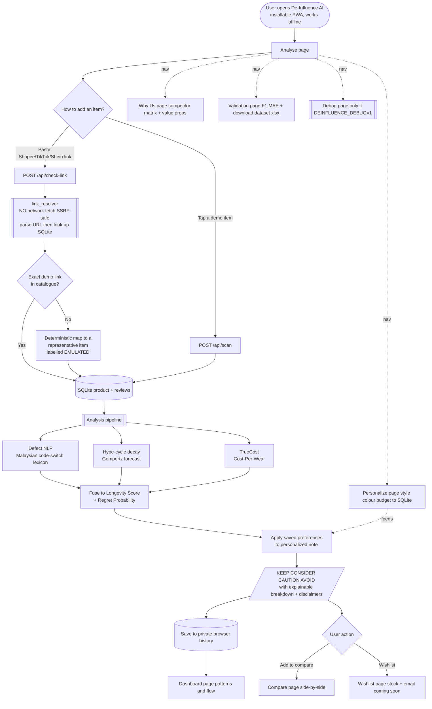

# De-Influence AI — User Interaction Flow

For pitching and presentation. Paste this Mermaid block into any Mermaid viewer
(e.g. mermaid.live) or a Markdown renderer that supports Mermaid to see the diagram.

## Narration for the pitch

1. **Open** — the app installs as a PWA and works offline.
2. **Analyse** — the shopper pastes a product link (or taps a demo). We never fetch the live
   page (platform restrictions + SSRF safety); the link resolves against our own SQLite catalogue,
   with unknown links clearly labelled as an emulated demo.
3. **Engines** — three signals run: localized Malaysian defect NLP, Gompertz trend-decay, and
   Cost-Per-Wear. They fuse into an explainable Longevity Score and Regret Probability, then a
   personalization note is applied from saved preferences.
4. **Verdict** — KEEP / CONSIDER / CAUTION / AVOID, with the score breakdown and responsible-use
   disclaimers. The result is saved to the shopper's private, on-device history.
5. **Act** — add to compare, add to wishlist, or review patterns on the dashboard.
6. **Trust pages** — Why Us (market positioning), Validation (real F1/MAE + downloadable dataset),
   and a terminal-toggled Debug page for live inspection.
